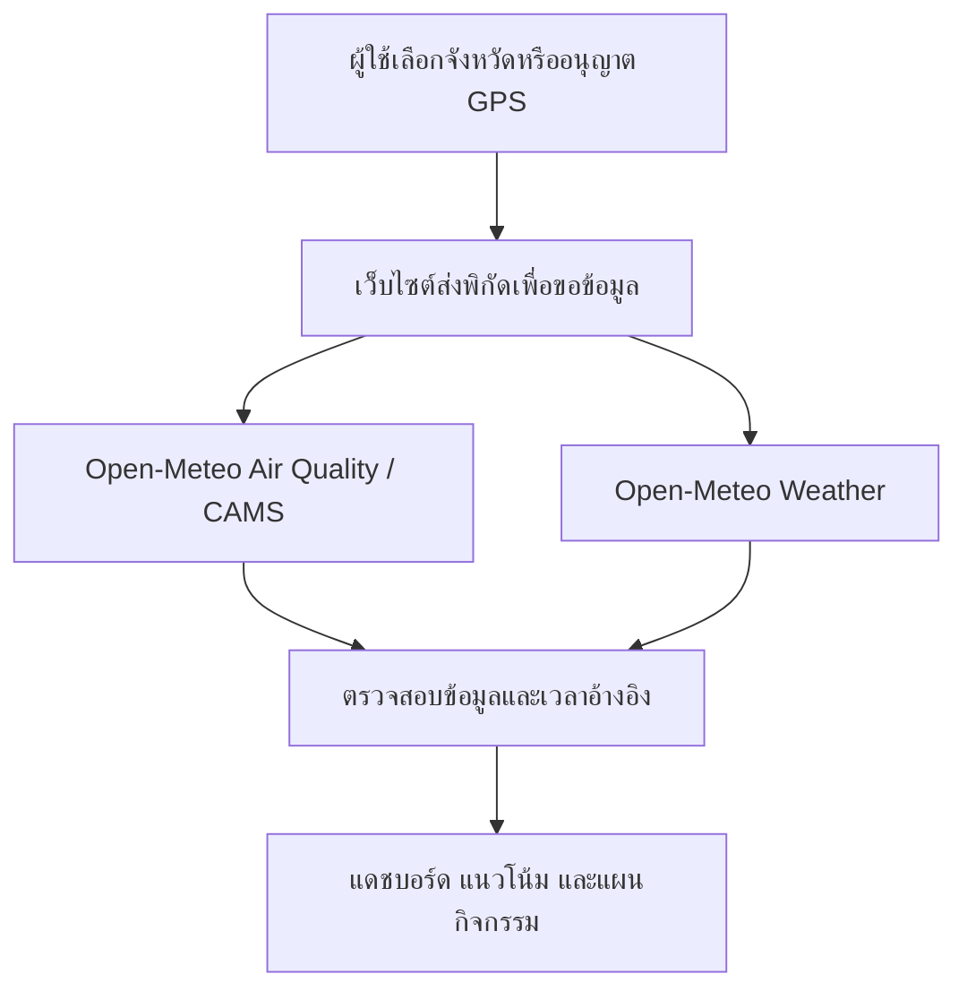

<div align="center">

# 🌿 AirGuard AI
### อากาศที่เข้าใจง่าย · รู้ก่อน ปรับแผนได้ก่อน

**Machine Learning-Based PM2.5 Prediction & Health Risk Alert System**

ระบบต้นแบบสำหรับแสดงข้อมูลฝุ่น PM2.5 สื่อสารความเสี่ยง  
และช่วยวางแผนกิจกรรมกลางแจ้งจากแนวโน้มคุณภาพอากาศ


**มหาวิทยาลัยขอนแก่น วิทยาเขตหนองคาย**  
Khon Kaen University, Nong Khai Campus

</div>

---

> **สถานะสำคัญของโครงการ**
>
> เว็บไซต์รุ่นปัจจุบันใช้ข้อมูลฝุ่นและแนวโน้มจาก **Open-Meteo / CAMS**  
> โมเดล Machine Learning ที่พัฒนาภายใต้โครงการ **ยังไม่ได้เชื่อมต่อกับผลพยากรณ์บนเว็บไซต์**
>
> ชื่อโครงการสะท้อนขอบเขตงานวิจัย ส่วนความสามารถที่เปิดใช้งานจริงอธิบายไว้ในเอกสารนี้

## 📑 สารบัญ

- [เกี่ยวกับโครงการ](#-เกี่ยวกับโครงการ)
- [วัตถุประสงค์](#-วัตถุประสงค์)
- [ลิงก์โครงการ](#-ลิงก์โครงการ)
- [ความสามารถของเว็บไซต์](#-ความสามารถของเว็บไซต์)
- [ตัวอย่างหน้าจอ](#-ตัวอย่างหน้าจอ)
- [ภาพรวมการทำงาน](#-ภาพรวมการทำงาน)
- [แหล่งข้อมูล](#-แหล่งข้อมูล)
- [การแสดงค่าฝุ่นและคำแนะนำ](#-การแสดงค่าฝุ่นและคำแนะนำ)
- [สถานะงานวิจัย Machine Learning](#-สถานะงานวิจัย-machine-learning)
- [บทบาทของเว็บไซต์และแอปพลิเคชัน](#-บทบาทของเว็บไซต์และแอปพลิเคชัน)
- [การเริ่มต้นใช้งาน](#-การเริ่มต้นใช้งาน)
- [ความเป็นส่วนตัว](#-ความเป็นส่วนตัว)
- [ข้อจำกัดของระบบ](#-ข้อจำกัดของระบบ)
- [แนวทางพัฒนาต่อ](#-แนวทางพัฒนาต่อ)
- [ผู้พัฒนา](#-ผู้พัฒนา)

---

## 🌏 เกี่ยวกับโครงการ

**AirGuard AI** เป็นโครงการพัฒนาระบบข้อมูลคุณภาพอากาศที่มุ่งช่วยให้ผู้ใช้เข้าใจค่าฝุ่น PM2.5 และนำข้อมูลไปประกอบการตัดสินใจในชีวิตประจำวัน

การทราบเพียงว่า “ค่าฝุ่นเท่าไร” อาจยังไม่เพียงพอต่อการวางแผน ผู้ใช้ยังต้องการทราบว่าแนวโน้มฝุ่นจะเปลี่ยนแปลงอย่างไร พื้นที่ใดมีค่าฝุ่นแตกต่างกัน และช่วงเวลาใดเหมาะสำหรับปรับแผนกิจกรรมกลางแจ้ง

โครงการจึงออกแบบเว็บไซต์ให้แสดงข้อมูลอากาศ แนวโน้ม และเครื่องมือวางแผนกิจกรรมในรูปแบบที่อ่านง่าย พร้อมระบุแหล่งข้อมูล เวลาอ้างอิง และข้อจำกัดของผลลัพธ์

> **แนวคิดของโครงการ:** เปลี่ยนข้อมูลอากาศให้เป็นข้อมูลที่ช่วยตัดสินใจได้

---

## 🎯 วัตถุประสงค์

1. แสดงข้อมูลฝุ่น PM2.5 และสภาพอากาศในรูปแบบที่เข้าใจง่าย
2. ช่วยให้ผู้ใช้ติดตามแนวโน้มฝุ่นและเปรียบเทียบช่วงเวลาสำหรับกิจกรรมกลางแจ้ง
3. สื่อสารคำแนะนำทั่วไปให้เหมาะกับกิจกรรมและกลุ่มผู้ใช้
4. ศึกษาการพัฒนาและประเมินโมเดล Machine Learning สำหรับพยากรณ์ PM2.5
5. วางแนวทางเชื่อมผลการวิจัยเข้ากับระบบใช้งานจริงในอนาคต

---

## 🔗 ลิงก์โครงการ

<!-- แทนที่ข้อความด้านล่างด้วย URL จริงก่อนเผยแพร่ README -->

| รายการ | ลิงก์ |
|---|---|
| 🌐 เว็บไซต์ AirGuard AI | Web: https://ice55yo1234.github.io/AirGuard-AI-/#project |
| 💻 GitHub Repository | https://github.com/Ice55yo1234/AirGuard-AI- |
| 🌤️ Open-Meteo | https://open-meteo.com/ |
| 🌫️ CAMS | https://atmosphere.copernicus.eu/ |

---

## ✨ ความสามารถของเว็บไซต์

### 📊 1. แดชบอร์ดคุณภาพอากาศ

แสดงข้อมูลสำคัญของพื้นที่ที่ผู้ใช้เลือก ได้แก่

- ความเข้มข้นของฝุ่น PM2.5 หน่วย **µg/m³**
- ระดับสีเพื่อช่วยอ่านค่าฝุ่น
- อุณหภูมิ
- ความชื้นสัมพัทธ์
- ความเร็วลม
- เวลาอ้างอิงของข้อมูล

เมื่อไม่สามารถโหลดข้อมูลได้ ระบบแสดงสถานะให้ผู้ใช้ทราบ โดยไม่สร้างตัวเลขทดแทน

### 📈 2. แนวโน้มฝุ่นล่วงหน้า

- แสดงแนวโน้ม PM2.5 ล่วงหน้าสูงสุด **72 ชั่วโมง**
- ช่วยสังเกตช่วงที่ค่าฝุ่นมีแนวโน้มเพิ่มขึ้นหรือลดลง
- แสดงเวลาในเขตเวลาไทย **UTC+7**
- ใช้ประกอบการวางแผนและตรวจสอบอีกครั้งก่อนทำกิจกรรมจริง

> ระยะข้อมูลที่แสดงได้ขึ้นอยู่กับข้อมูลที่ API ส่งกลับมาในแต่ละครั้ง

### 🗓️ 3. เครื่องมือวางแผนกิจกรรมกลางแจ้ง

ช่วยเปรียบเทียบช่วงเวลาที่ค่าฝุ่นคาดการณ์ต่ำกว่าช่วงอื่นภายใต้เงื่อนไขที่เลือก เพื่อประกอบการปรับเวลาออกกำลังกาย เดินทาง หรือทำกิจกรรมกลางแจ้ง

ผลลัพธ์เป็นการเปรียบเทียบจากข้อมูลที่มี ไม่ใช่การรับรองว่าช่วงเวลาดังกล่าวปลอดภัยสำหรับทุกคน

### 📍 4. การเลือกพื้นที่

- เลือกจังหวัดที่ต้องการตรวจสอบ
- ขอใช้ตำแหน่งปัจจุบันเมื่อผู้ใช้กดอนุญาต
- บันทึกพื้นที่โปรดไว้ในเบราว์เซอร์
- เปรียบเทียบข้อมูลของพื้นที่ที่สนใจ

เมื่อเลือกจังหวัด ระบบใช้พิกัดตัวแทนจังหวัด ซึ่งอาจไม่ตรงกับตำแหน่งจริงของผู้ใช้

### 💚 5. คำแนะนำตามกลุ่มผู้ใช้และกิจกรรม

เว็บไซต์จัดกลุ่มคำแนะนำให้อ่านง่าย เช่น

| กลุ่ม | แนวทางการใช้งาน |
|---|---|
| ผู้ใช้ทั่วไป | ประกอบการวางแผนเดินทางและกิจกรรมประจำวัน |
| เด็ก / ผู้สูงอายุ | เพิ่มความระมัดระวังในการวางแผนกิจกรรม |
| ผู้ที่ออกกำลังกาย | ประกอบการปรับเวลาและรูปแบบกิจกรรมกลางแจ้ง |

คำแนะนำเป็นข้อมูลทั่วไป ระบบไม่ได้ประเมินโรคประจำตัวหรือวินิจฉัยสุขภาพรายบุคคล

### 🧭 6. การแสดงที่มาและข้อจำกัด

- ระบุแหล่งข้อมูลที่นำมาใช้
- แยกข้อมูลจาก API ออกจากโมเดลวิจัยของโครงการ
- อธิบายความแตกต่างระหว่างค่าความเข้มข้น PM2.5 และ AQI
- แสดงสถานะเมื่อข้อมูลไม่พร้อมใช้งาน

---

## 🖼️ ตัวอย่างหน้าจอ

<!--
เพิ่มภาพหน้าจอจริงลงใน Repository แล้วเปลี่ยนส่วนนี้เป็นลิงก์ภาพ เช่น


ตัวอย่างเส้นทางด้านบนเป็นแนวทางจัดเก็บภาพ ไม่ใช่การยืนยันว่ามีไฟล์เหล่านี้อยู่แล้ว
-->

อยู่ระหว่างเพิ่มภาพหน้าจอของระบบรุ่นปัจจุบัน

| หน้าจอ | รายละเอียด |
|---|---|
| หน้าแนะนำโครงการ | แนวคิด วัตถุประสงค์ และสถานะการพัฒนา |
| แดชบอร์ดอากาศ | ข้อมูลฝุ่นและสภาพอากาศของพื้นที่ที่เลือก |
| หน้าแนวโน้ม | แนวโน้ม PM2.5 ตามช่วงเวลา |
| หน้าวางแผนกิจกรรม | เปรียบเทียบช่วงเวลาสำหรับกิจกรรมกลางแจ้ง |
| พื้นที่โปรด | เข้าถึงพื้นที่ที่บันทึกไว้ |
| ที่มาและความเป็นส่วนตัว | แหล่งข้อมูล ข้อจำกัด และการจัดการข้อมูลในอุปกรณ์ |

---

## ⚙️ ภาพรวมการทำงาน



### ลำดับการทำงาน

1. ผู้ใช้เลือกจังหวัดหรืออนุญาตให้ใช้ตำแหน่งปัจจุบัน
2. เว็บไซต์ขอข้อมูลอากาศตามพิกัดที่เลือก
3. ระบบตรวจสอบความพร้อมของข้อมูลและเวลาอ้างอิง
4. เว็บไซต์แสดงค่าฝุ่น สภาพอากาศ และแนวโน้ม
5. ผู้ใช้เปรียบเทียบช่วงเวลาและนำข้อมูลไปประกอบการวางแผน

**ผลพยากรณ์บนเว็บไซต์ในรุ่นปัจจุบันมาจาก API ไม่ได้ผ่านโมเดล Machine Learning ของโครงการ**

---

## 🗂️ แหล่งข้อมูล

### ข้อมูลที่ใช้บนเว็บไซต์

| ข้อมูล | แหล่งข้อมูล | การใช้งาน |
|---|---|---|
| PM2.5 และแนวโน้มคุณภาพอากาศ | Open-Meteo Air Quality / CAMS | แสดงค่าฝุ่นและแนวโน้ม |
| อุณหภูมิ ความชื้น และลม | Open-Meteo Weather | แสดงสภาพอากาศประกอบ |
| พิกัดพื้นที่ | จังหวัดที่เลือก หรือ GPS ที่ผู้ใช้อนุญาต | ระบุพื้นที่ในการขอข้อมูล |

### ข้อมูลสำหรับงานวิจัย

โครงการมีขอบเขตศึกษาข้อมูล PM2.5 ย้อนหลังจาก **Air4Thai กรมควบคุมมลพิษ** เพื่อใช้เตรียมข้อมูล พัฒนา และประเมินโมเดล Machine Learning

รายละเอียดช่วงเวลา จำนวนสถานี จำนวนตัวอย่าง และตัวแปรที่ใช้ ต้องอ้างอิงจากชุดข้อมูลและสคริปต์ทดลองฉบับที่ตรวจสอบแล้ว

### เอกสารที่เกี่ยวข้อง

- [Open-Meteo](https://open-meteo.com/)
- [Open-Meteo Air Quality API](https://open-meteo.com/en/docs/air-quality-api)
- [Open-Meteo Weather API](https://open-meteo.com/en/docs)
- [Copernicus Atmosphere Monitoring Service](https://atmosphere.copernicus.eu/)
- [เงื่อนไขการใช้บริการ Open-Meteo](https://open-meteo.com/en/terms)

---

## 🎨 การแสดงค่าฝุ่นและคำแนะนำ

เว็บไซต์แสดง **ความเข้มข้น PM2.5** หน่วยไมโครกรัมต่อลูกบาศก์เมตร และแบ่งช่วงสีเพื่อช่วยให้ผู้ใช้ตีความตัวเลขได้ง่ายขึ้น

| PM2.5 (µg/m³) | ระดับที่แสดงในเว็บไซต์ |
|---:|---|
| ≤ 15 | 🌱 ฝุ่นต่ำ |
| > 15–25 | 🙂 ค่อนข้างต่ำ |
| > 25–37.5 | 😷 ควรระวัง |
| > 37.5–75 | 🏠 ฝุ่นสูง |
| > 75 | ⚠️ สูงมาก |

> ตารางนี้เป็นช่วงการแสดงผลความเข้มข้นที่ใช้ในเว็บไซต์  
> ไม่ใช่ค่าดัชนี AQI และไม่ควรนำไปตีความเป็นเกณฑ์รับรองความปลอดภัยในการสัมผัสฝุ่นระยะยาว

### หลักการใช้ข้อมูล

- ตรวจสอบเวลาอ้างอิงทุกครั้ง
- ดูแนวโน้มร่วมกับสภาพแวดล้อมจริง
- ตรวจข้อมูลอีกครั้งก่อนออกจากบ้าน
- พิจารณาสุขภาพและข้อจำกัดของตนเอง
- หากข้อมูลไม่พร้อม ให้รออัปเดตแทนการตีความจากค่าที่ขาดหาย

---

## 🤖 สถานะงานวิจัย Machine Learning

### เป้าหมายการวิจัย

ศึกษาการใช้ Machine Learning เพื่อพยากรณ์ PM2.5 จากข้อมูลย้อนหลังและตัวแปรที่เกี่ยวข้อง พร้อมเปรียบเทียบประสิทธิภาพกับวิธีพื้นฐาน

### โมเดลในขอบเขตการศึกษา

- Linear Regression
- Decision Tree
- Random Forest
- Gradient Boosting หรือ XGBoost ตามสคริปต์ทดลองที่ใช้จริง

> Gradient Boosting และ XGBoost ต้องรายงานแยกตามตัวแบบที่ทดลองจริง ไม่ใช้ชื่อแทนกันโดยไม่มีรายละเอียด

### แนวทางเตรียมข้อมูล

1. ตรวจสอบรูปแบบวันที่ หน่วย และความสอดคล้องของข้อมูล
2. ตรวจสอบค่าที่ขาดหายและค่าผิดปกติ
3. จัดเรียงข้อมูลตามลำดับเวลา
4. สร้างตัวแปรจากข้อมูลในอดีตตามความเหมาะสม
5. แบ่งข้อมูลฝึก ตรวจสอบ และทดสอบตามช่วงเวลา
6. ป้องกันข้อมูลอนาคตรั่วไหลเข้าสู่ขั้นตอนฝึกโมเดล

การเติมค่าที่ขาดหาย การปรับสเกล และการเลือกตัวแปรต้องออกแบบให้สอดคล้องกับสถานการณ์พยากรณ์จริง

### ตัวชี้วัดสำหรับประเมินผล

| ตัวชี้วัด | ความหมาย | แนวทางพิจารณา |
|---|---|---|
| MAE | ค่าเฉลี่ยของความคลาดเคลื่อนสัมบูรณ์ | ค่าต่ำแสดงว่าคลาดเคลื่อนเฉลี่ยน้อย |
| RMSE | รากที่สองของค่าเฉลี่ยความคลาดเคลื่อนกำลังสอง | ให้น้ำหนักกับความผิดพลาดขนาดใหญ่มากขึ้น |
| R² | ความสามารถในการอธิบายความแปรปรวนเทียบกับค่าคงที่เฉลี่ย | ค่าสูงขึ้นโดยทั่วไปดีกว่า และอาจติดลบได้ |
| เวลาในการฝึก | เวลาที่ใช้สร้างโมเดล | ใช้ประกอบการประเมินทรัพยากร |
| เวลาในการพยากรณ์ | เวลาที่ใช้สร้างผลลัพธ์ | ใช้ประกอบการออกแบบระบบใช้งานจริง |

### การรายงานผลทดลอง

ยังไม่แสดงตัวเลขความแม่นยำใน README ฉบับนี้ จนกว่าจะตรวจสอบผลลัพธ์ให้ตรงกับข้อมูล สคริปต์ และวิธีแบ่งชุดทดสอบที่ใช้จริง

รายงานผลแต่ละครั้งควรระบุอย่างน้อย:

- ช่วงเวลาและขอบเขตพื้นที่ของข้อมูล
- ตัวแปรนำเข้าและเป้าหมายการพยากรณ์
- ระยะเวลาที่พยากรณ์ล่วงหน้า
- วิธีแบ่งข้อมูลฝึกและทดสอบ
- วิธีจัดการค่าที่ขาดหาย
- พารามิเตอร์และเวอร์ชันไลบรารี
- ผลเปรียบเทียบกับวิธีพื้นฐาน เช่น การใช้ค่าล่าสุด
- ข้อจำกัดของการนำผลไปใช้กับพื้นที่หรือช่วงเวลาอื่น

**ผลทดลองโมเดลวิจัยไม่ใช่ตัวเลขความแม่นยำของข้อมูล Open-Meteo ที่แสดงบนเว็บไซต์**

---

## 🖥️ บทบาทของเว็บไซต์และแอปพลิเคชัน

โครงการออกแบบให้เว็บไซต์และแอปพลิเคชันมีบทบาทที่เสริมกัน โดยความสามารถของแอปในตารางเป็นแนวทางการออกแบบ ยังไม่ใช่การยืนยันว่าเปิดใช้งานครบแล้ว

| ประเด็น | เว็บไซต์รุ่นปัจจุบัน | แอปพลิเคชันตามแนวทางออกแบบ |
|---|---|---|
| เป้าหมาย | สำรวจข้อมูล วิเคราะห์แนวโน้ม และวางแผน | เข้าถึงข้อมูลระหว่างวัน |
| การเข้าถึง | เปิดผ่านเบราว์เซอร์ | เปิดผ่านแอปบนอุปกรณ์ |
| การดูข้อมูล | แดชบอร์ดและแนวโน้ม | ข้อมูลสรุปที่เข้าถึงได้รวดเร็ว |
| ตำแหน่ง | ขอใช้ GPS เมื่อผู้ใช้กดอนุญาต | ใช้ตำแหน่งตามสิทธิ์และการตั้งค่า |
| การแจ้งเตือน | ไม่มีการแจ้งเตือนขณะปิดหน้าเว็บ | ออกแบบให้รองรับการแจ้งเตือนตามกิจวัตร |
| การนำเสนอ | เหมาะกับการดูภาพรวมและนำเสนอโครงการ | เหมาะกับการใช้งานขณะเดินทาง |

การแจ้งเตือนบนแอปต้องมีบริการรองรับและได้รับสิทธิ์จากผู้ใช้ก่อน จึงจะสามารถทำงานได้ตามที่ออกแบบไว้

---

## 🚀 การเริ่มต้นใช้งาน

### สำหรับผู้ใช้ทั่วไป

1. เปิดเว็บไซต์ AirGuard AI
2. เลือกจังหวัดหรือกดใช้ตำแหน่งปัจจุบัน
3. ตรวจสอบค่าฝุ่นและเวลาอ้างอิง
4. เปิดดูแนวโน้มในช่วงเวลาที่สนใจ
5. ใช้เครื่องมือวางแผนกิจกรรมเพื่อเปรียบเทียบช่วงเวลา
6. กดอัปเดตข้อมูลเมื่อต้องการตรวจสอบอีกครั้ง

### สำหรับผู้พัฒนา

คำสั่งด้านล่างใช้สำหรับซอร์สเว็บไซต์แบบ Static ที่มี `index.html` เป็นหน้าเริ่มต้น หากใช้โครงสร้างหรือเครื่องมือ build อื่น ให้ใช้คำสั่งตามไฟล์ตั้งค่าของรุ่นนั้น

#### 1. ดาวน์โหลดซอร์สโค้ด

```bash
git clone <YOUR_REPOSITORY_URL>
```

เปลี่ยน `<YOUR_REPOSITORY_URL>` เป็น URL ของ Repository จริง แล้วเปิดโฟลเดอร์ที่ดาวน์โหลดมา

#### 2. เปิด Local Server

หากติดตั้ง Python ไว้แล้ว ให้รันคำสั่งนี้จากโฟลเดอร์เว็บไซต์:

```bash
python -m http.server 8000
```

จากนั้นเปิด:

```text
http://localhost:8000
```

หรือใช้ VS Code ร่วมกับส่วนขยาย Live Server เพื่อเปิดเว็บไซต์ในเครื่อง

#### 3. ตรวจสอบการทำงาน

- อุปกรณ์เชื่อมต่ออินเทอร์เน็ต
- เว็บไซต์โหลดข้อมูลจาก API ได้
- เวลาอ้างอิงแสดงถูกต้อง
- เมื่อปฏิเสธ GPS ยังสามารถเลือกจังหวัดได้
- เมื่อ API ขัดข้อง ระบบแสดงสถานะข้อมูลไม่พร้อม
- หน้าจอใช้งานได้ทั้งบนคอมพิวเตอร์และมือถือ

> การใช้ GPS อาจต้องเปิดผ่าน HTTPS หรือ localhost และต้องได้รับอนุญาตจากผู้ใช้

---

## 🔐 ความเป็นส่วนตัว

### ข้อมูลที่เว็บไซต์ใช้

เว็บไซต์ส่งพิกัดจังหวัดที่เลือก หรือพิกัด GPS เมื่อผู้ใช้อนุญาต ไปยังผู้ให้บริการข้อมูลอากาศเพื่อขอข้อมูลของพื้นที่นั้น

ผู้ให้บริการ API และโฮสติ้งอาจได้รับข้อมูลการเชื่อมต่อ เช่น IP Address ตามนโยบายของแต่ละบริการ

### ข้อมูลที่บันทึกในเบราว์เซอร์

- จังหวัดที่เลือกล่าสุด
- พื้นที่โปรด
- ตัวเลือกเปิดหรือหยุดแอนิเมชัน

หากผู้ใช้เลือกบันทึก GPS เป็นพื้นที่โปรด ระบบจะแจ้งและขอการยืนยันก่อนบันทึก

### ขอบเขตของรุ่นปัจจุบัน

- ใช้งานได้โดยไม่สมัครบัญชี
- ไม่เก็บข้อมูลโรคประจำตัว
- ไม่มีการติดตาม GPS เบื้องหลัง
- ข้อมูลการตั้งค่าเก็บในเบราว์เซอร์ของอุปกรณ์
- มีตัวเลือกสำหรับล้างข้อมูลที่เว็บไซต์บันทึกไว้
- ข้อมูลอากาศเก็บชั่วคราวในหน่วยความจำไม่เกิน 5 นาที

การล้างข้อมูลของ AirGuard มีผลเฉพาะข้อมูลที่เว็บไซต์บันทึกในเบราว์เซอร์นั้น

---

## ⚠️ ข้อจำกัดของระบบ

1. **ค่าฝุ่นมาจากแบบจำลอง**  
   ข้อมูลบนเว็บไซต์ไม่ใช่ค่าที่วัดโดยตรงจากสถานีตรวจวัด ณ ตำแหน่งของผู้ใช้

2. **ผลพยากรณ์มีความไม่แน่นอน**  
   สภาพอากาศ แหล่งกำเนิดมลพิษ และความละเอียดเชิงพื้นที่อาจทำให้ค่าจริงแตกต่างจากข้อมูลที่แสดง

3. **พิกัดจังหวัดเป็นตำแหน่งตัวแทน**  
   ค่าของจังหวัดอาจไม่สะท้อนสภาพอากาศบริเวณบ้าน ถนน หรืออาคารแต่ละแห่ง

4. **การใช้งานขึ้นอยู่กับ API และอินเทอร์เน็ต**  
   หากบริการต้นทางไม่พร้อม เว็บไซต์อาจแสดงข้อมูลบางส่วนไม่ได้

5. **ข้อมูล PM2.5 ไม่ใช่ AQI**  
   ตัวเลขความเข้มข้นและดัชนีคุณภาพอากาศเป็นคนละรูปแบบการรายงาน

6. **คำแนะนำไม่ใช่การวินิจฉัยทางการแพทย์**  
   ระบบไม่สามารถประเมินความเสี่ยงเฉพาะบุคคลหรือรับรองความปลอดภัยของกิจกรรมได้

7. **โมเดลวิจัยยังไม่เชื่อมกับเว็บไซต์**  
   ไม่ควรนำผลการทดลอง Machine Learning มาอ้างว่าเป็นประสิทธิภาพของข้อมูลที่แสดงบนเว็บ

8. **ไม่มีการแจ้งเตือนขณะปิดหน้าเว็บในรุ่นปัจจุบัน**  
   ความสามารถดังกล่าวต้องพัฒนาและทดสอบเพิ่มเติม

---

## 🛠️ แนวทางพัฒนาต่อ

รายการต่อไปนี้เป็นแผนการพัฒนา ไม่ใช่ความสามารถที่เปิดใช้งานแล้วทั้งหมด

- [ ] ตรวจสอบและจัดทำเอกสารชุดข้อมูลวิจัย
- [ ] จัดทำขั้นตอนทดลองโมเดลที่สามารถทำซ้ำได้
- [ ] ประเมินโมเดลด้วยการแบ่งข้อมูลตามลำดับเวลา
- [ ] เปรียบเทียบโมเดลกับวิธีพยากรณ์พื้นฐาน
- [ ] เชื่อมโมเดลที่ผ่านการประเมินเข้ากับบริการพยากรณ์
- [ ] แสดงแหล่งที่มาของผลพยากรณ์แต่ละประเภทให้ชัดเจน
- [ ] ประเมินผลกับข้อมูลหลายพื้นที่และหลายฤดูกาล
- [ ] พัฒนาแอปพลิเคชันสำหรับการใช้งานระหว่างวัน
- [ ] พัฒนาการแจ้งเตือนตามการตั้งค่าของผู้ใช้
- [ ] ทดสอบการใช้งานกับผู้ใช้จริง
- [ ] ปรับปรุงการเข้าถึงสำหรับผู้ใช้ที่มีข้อจำกัดด้านการมองเห็น

---

## 👨‍💻 ผู้พัฒนา

**รพีภัทร ผาบพุทธา 663450045-2**
**นางสาวสุธาสิณี วิชัยวงษ์ 663450311-7**  

มหาวิทยาลัยขอนแก่น วิทยาเขตหนองคาย  
Khon Kaen University, Nong Khai Campus

📧 อีเมล: [rapeephat.ph@kkumail.com](mailto:rapeephat.ph@kkumail.com)

---

## 📄 การใช้โค้ดและข้อมูล

เงื่อนไขการใช้ซอร์สโค้ดให้ตรวจสอบจากไฟล์ `LICENSE` ของ Repository หากมี

ข้อมูลและบริการจากบุคคลภายนอกอยู่ภายใต้เงื่อนไขของผู้ให้บริการแต่ละราย การนำไปใช้ต่อควรตรวจสอบข้อกำหนดและการให้เครดิตแหล่งข้อมูลก่อนเผยแพร่

---

<div align="center">

### 🌿 AirGuard AI

**รู้ก่อน ปรับแผนได้ก่อน**

ข้อมูลอากาศเพื่อประกอบการตัดสินใจในชีวิตประจำวัน

</div>
